<div align="center">

<a href="https://muhammadmaheem.github.io/MuhammadMaheem.Portfolio/">
  
</a>

<br>

<a href="https://muhammadmaheem.github.io/MuhammadMaheem.Portfolio/"></a>
<a href="https://www.linkedin.com/in/muhammad-maheem/"></a>
<a href="https://github.com/MuhammadMaheem"></a>
<a href="https://muhammadmaheem.github.io/MuhammadMaheem.Portfolio/Muhammad-Maheem-Resume.pdf"></a>
<a href="mailto:mirza.muhammad.maheem@gmail.com"></a>
<br>


</div>

## 👋 In 10 seconds

<table>
<tr><td width="170"><b>What I do</b></td><td>I build AI tools that companies use to <b>search, summarise and review documents</b>: chatbots that answer from your files, analysers that flag risks in contracts, and systems that rank job candidates.</td></tr>
<tr><td><b>Where I've worked</b></td><td><b>TEYZIX CORE</b> (AI Engineer Intern) · <b>Punjab Skill Development Authority</b> (built their platform as the only engineer) · <b>AABS</b> (Software Engineer Intern)</td></tr>
<tr><td><b>Proof it works</b></td><td>16+ shipped projects, including <a href="https://recruit-ai-mu.vercel.app">RecruitAI, live here</a>, and a full government SaaS platform delivered solo, from design to production.</td></tr>
<tr><td><b>Education</b></td><td>BS Artificial Intelligence, Superior University, Lahore (2024 — 2028) · 5th semester · CGPA 3.56</td></tr>
<tr><td><b>Looking for</b></td><td>An <b>onsite AI Engineer</b> role in <b>Lahore</b>. Available now.</td></tr>
</table>

<sub>Engineer? Jump to the <a href="#-flagship-project--autonomous-research-agent-swarm">architecture</a>, the <a href="scripts/chess_game.py">chess engine source</a> or the <a href="scripts/heartbeat.py">heartbeat renderer</a>.</sub>

## 💼 Experience

| Role | Company | When | What I delivered |
| :-- | :-- | :-- | :-- |
| **AI Engineer Intern** | TEYZIX CORE | Jun 2026 — Jul 2026 | Built AI tools that review legal contracts for risk, rank job candidates, and summarise long documents in 16+ languages. |
| **AI Developer Intern** | Punjab Skill Development Authority (PSDA) | Mar 2026 — May 2026 | As the **only engineer**, took a full web platform from design to production: public site, admin dashboard, user roles, and an AI that reads uploaded documents. |
| **Software Engineer Intern** | Artificial Automation Business Solutions (AABS) | Sep 2025 — Nov 2025 | Built a chatbot that answers questions from PDF files, plus dashboard screens for login, analytics and subscriptions. |

<details>
<summary><sub><b>Engineer view:</b> <code>git log --graph --career</code></sub></summary>

```text
* Jun 2026 — Jul 2026  (HEAD -> ai-engineer)  AI Engineer Intern @ TEYZIX CORE
|   + legal-tech contract risk analyzer: 7-stage async pipeline (FastAPI + Next.js 15),
|     clause extraction, risk flags with confidence scores, explainable compliance score
|     via RAG over ChromaDB
|   + RecruitAI: resume screening & candidate ranking with Groq + ChromaDB, live on Vercel + Railway
|   + hybrid summarizer: TF-IDF/positional extractive + BART abstractive, 16+ languages
|
* Mar 2026 — May 2026  (tag: sole-engineer)  AI Developer Intern @ Punjab Skill Development Authority (PSDA)
|   + delivered a full-stack SaaS alone, from Figma specs to production (Next.js, Tailwind, PostgreSQL)
|   + public site, admin dashboard, 3-role permission system across 8+ REST endpoints
|   + Gemini-powered OCR parser wired into the backend for multi-page document processing
|
* Sep 2025 — Nov 2025  (tag: first-rag)  Software Engineer Intern @ Artificial Automation Business Solutions (AABS)
|   + RAG PDF chatbot: embedding model selection, ChromaDB indexing, grounded answers
|   + SaaS dashboard UI in Next.js 15 / React 19: auth, analytics, subscriptions
|
* 2024 — 2028         (root)  git init — BS Artificial Intelligence @ Superior University, Lahore (5th semester)
```

</details>

## 🚀 What I've built

<table>
<tr>
<td width="33%" valign="top">
<a href="https://recruit-ai-mu.vercel.app"></a>
<h3>RecruitAI</h3>
Upload résumés and a job description. It <b>ranks every candidate out of 100</b> and explains why.<br><br>
<a href="https://recruit-ai-mu.vercel.app"></a> <a href="https://github.com/MuhammadMaheem/RecruitAI"></a>
</td>
<td width="33%" valign="top">
<a href="https://github.com/MuhammadMaheem/Contact-Risk-Analyzer"></a>
<h3>Contract Risk Analyzer</h3>
Upload a contract, even a scanned one. It <b>highlights risky clauses</b>, suggests fixes and gives a compliance score.<br><br>
<a href="https://github.com/MuhammadMaheem/Contact-Risk-Analyzer"></a>
</td>
<td width="33%" valign="top">
<a href="https://github.com/MuhammadMaheem/Autonomous-Research-Agent-Swarm"></a>
<h3>Research Agent Swarm</h3>
Ask a hard question. A team of AI agents <b>researches it in parallel</b> and fact-checks every sentence.<br><br>
<a href="https://github.com/MuhammadMaheem/Autonomous-Research-Agent-Swarm"></a>
</td>
</tr>
</table>

| Project | What it does, in plain words | Built with | |
| :-- | :-- | :-- | :-: |
| **DocuQuery** | Chatbot for your PDFs that is automatically tested, and blocked from release if its answers get worse | <sub>FastAPI · LangGraph · RAGAS · Groq</sub> | <a href="https://github.com/MuhammadMaheem/Quality-Evaluation-RAG-chatbot"></a> |
| **Agentic PDF Chatbot** | Upload PDFs and chat with them; each user gets a private, secure workspace | <sub>FastAPI · Next.js · PostgreSQL</sub> | <a href="https://github.com/MuhammadMaheem/PDF-Chatbot-Rag"></a> |
| **Hadith Chatbot** | Search 39,038 hadiths by meaning, not just keywords | <sub>LangChain · FAISS · BM25</sub> | <a href="https://github.com/MuhammadMaheem/Hadith-Chatbot"></a> |
| **Document Summarizer** | Turns long documents into short summaries, in 16+ languages | <sub>Flask · BART · TF-IDF</sub> | <a href="https://github.com/MuhammadMaheem/AI-Powered-Document-Summarization-System"></a> |
| **Tic-Tac-Toe AI** | Taught itself to play by playing 100,000 games; wins or draws over 98% of the time | <sub>PyTorch · reinforcement learning</sub> | <a href="https://github.com/MuhammadMaheem/tic-tac-toe-Deep-Q-learning"></a> |
| **Face Attendance** | Marks attendance by face and can't be fooled by a photo or video | <sub>OpenCV · Dlib</sub> | <sub>private</sub> |

<sub>See all my work on the <a href="https://muhammadmaheem.github.io/MuhammadMaheem.Portfolio/">portfolio site</a>.</sub>

## 🐝 Flagship project · Autonomous Research Agent Swarm

> **In plain words:** you ask a question, several AI helpers research different parts of it at the same time, a writer combines what they found, and a reviewer checks every claim. If the answer isn't good enough, it goes back for another round.


<sub><b>Under the hood:</b> LangGraph state machine with persistence and loops · FastAPI streaming every step over SSE · Next.js + React Flow live DAG · SQLite event store · eval harness comparing the full swarm against a no-critic ablation and a single-agent baseline.</sub>

## 🛠️ Skills

Tools I use every day:

<div align="center">


<br>


</div>

| Area | In plain words | Tools |
| :-- | :-- | :-- |
| **AI that answers from documents** (RAG) | Chatbots that answer from your own files instead of guessing | <sub>ChromaDB · FAISS · BM25 · LangChain</sub> |
| **Teams of AI agents** | Several AIs splitting up a task and checking each other | <sub>LangGraph · MCP</sub> |
| **AI quality testing** | Automatic tests that catch an AI getting worse before users see it | <sub>RAGAS · golden datasets · CI</sub> |
| **Machine learning** | Models that predict, recognise faces or learn by trial and error | <sub>PyTorch · scikit-learn · OpenCV</sub> |
| **Full products** | The website, backend and database around the AI | <sub>FastAPI · Next.js · PostgreSQL · Docker</sub> |
| **Shipping** | Getting it live on the internet | <sub>Vercel · Railway · Neon · Firebase</sub> |

## 🫀 Pulse

> **In plain words:** my coding activity over the past year, drawn as a heartbeat. Each spike is one week; taller means busier. It updates itself every night.

<div align="center">
  
</div>

## ♟️ Play chess against my engine

> **In plain words:** this is a live game. Click any move below and an AI I programmed plays back within a minute. No setup needed, just a GitHub account.

<!-- CHESS:START -->
<div align="center">

**Game #1** · move 1 · Humans **0** – **0** Engine · 0 draws


</div>

**Your move — you're White.** Click a move below, GitHub opens a pre-filled issue, press **Submit**. A depth-3 alpha-beta engine I wrote answers as Black within a minute.

| Piece | Legal moves |
| :-- | :-- |
| ♙ Pawn | [`a3`](https://github.com/MuhammadMaheem/MuhammadMaheem/issues/new?title=chess%7Cmove%7Ca2a3%7C0&body=Just%20press%20%2A%2ASubmit%20new%20issue%2A%2A%20%E2%80%94%20no%20need%20to%20write%20anything.%20The%20engine%20replies%20in%20about%20a%20minute.) [`a4`](https://github.com/MuhammadMaheem/MuhammadMaheem/issues/new?title=chess%7Cmove%7Ca2a4%7C0&body=Just%20press%20%2A%2ASubmit%20new%20issue%2A%2A%20%E2%80%94%20no%20need%20to%20write%20anything.%20The%20engine%20replies%20in%20about%20a%20minute.) [`b3`](https://github.com/MuhammadMaheem/MuhammadMaheem/issues/new?title=chess%7Cmove%7Cb2b3%7C0&body=Just%20press%20%2A%2ASubmit%20new%20issue%2A%2A%20%E2%80%94%20no%20need%20to%20write%20anything.%20The%20engine%20replies%20in%20about%20a%20minute.) [`b4`](https://github.com/MuhammadMaheem/MuhammadMaheem/issues/new?title=chess%7Cmove%7Cb2b4%7C0&body=Just%20press%20%2A%2ASubmit%20new%20issue%2A%2A%20%E2%80%94%20no%20need%20to%20write%20anything.%20The%20engine%20replies%20in%20about%20a%20minute.) [`c3`](https://github.com/MuhammadMaheem/MuhammadMaheem/issues/new?title=chess%7Cmove%7Cc2c3%7C0&body=Just%20press%20%2A%2ASubmit%20new%20issue%2A%2A%20%E2%80%94%20no%20need%20to%20write%20anything.%20The%20engine%20replies%20in%20about%20a%20minute.) [`c4`](https://github.com/MuhammadMaheem/MuhammadMaheem/issues/new?title=chess%7Cmove%7Cc2c4%7C0&body=Just%20press%20%2A%2ASubmit%20new%20issue%2A%2A%20%E2%80%94%20no%20need%20to%20write%20anything.%20The%20engine%20replies%20in%20about%20a%20minute.) [`d3`](https://github.com/MuhammadMaheem/MuhammadMaheem/issues/new?title=chess%7Cmove%7Cd2d3%7C0&body=Just%20press%20%2A%2ASubmit%20new%20issue%2A%2A%20%E2%80%94%20no%20need%20to%20write%20anything.%20The%20engine%20replies%20in%20about%20a%20minute.) [`d4`](https://github.com/MuhammadMaheem/MuhammadMaheem/issues/new?title=chess%7Cmove%7Cd2d4%7C0&body=Just%20press%20%2A%2ASubmit%20new%20issue%2A%2A%20%E2%80%94%20no%20need%20to%20write%20anything.%20The%20engine%20replies%20in%20about%20a%20minute.) [`e3`](https://github.com/MuhammadMaheem/MuhammadMaheem/issues/new?title=chess%7Cmove%7Ce2e3%7C0&body=Just%20press%20%2A%2ASubmit%20new%20issue%2A%2A%20%E2%80%94%20no%20need%20to%20write%20anything.%20The%20engine%20replies%20in%20about%20a%20minute.) [`e4`](https://github.com/MuhammadMaheem/MuhammadMaheem/issues/new?title=chess%7Cmove%7Ce2e4%7C0&body=Just%20press%20%2A%2ASubmit%20new%20issue%2A%2A%20%E2%80%94%20no%20need%20to%20write%20anything.%20The%20engine%20replies%20in%20about%20a%20minute.) [`f3`](https://github.com/MuhammadMaheem/MuhammadMaheem/issues/new?title=chess%7Cmove%7Cf2f3%7C0&body=Just%20press%20%2A%2ASubmit%20new%20issue%2A%2A%20%E2%80%94%20no%20need%20to%20write%20anything.%20The%20engine%20replies%20in%20about%20a%20minute.) [`f4`](https://github.com/MuhammadMaheem/MuhammadMaheem/issues/new?title=chess%7Cmove%7Cf2f4%7C0&body=Just%20press%20%2A%2ASubmit%20new%20issue%2A%2A%20%E2%80%94%20no%20need%20to%20write%20anything.%20The%20engine%20replies%20in%20about%20a%20minute.) [`g3`](https://github.com/MuhammadMaheem/MuhammadMaheem/issues/new?title=chess%7Cmove%7Cg2g3%7C0&body=Just%20press%20%2A%2ASubmit%20new%20issue%2A%2A%20%E2%80%94%20no%20need%20to%20write%20anything.%20The%20engine%20replies%20in%20about%20a%20minute.) [`g4`](https://github.com/MuhammadMaheem/MuhammadMaheem/issues/new?title=chess%7Cmove%7Cg2g4%7C0&body=Just%20press%20%2A%2ASubmit%20new%20issue%2A%2A%20%E2%80%94%20no%20need%20to%20write%20anything.%20The%20engine%20replies%20in%20about%20a%20minute.) [`h3`](https://github.com/MuhammadMaheem/MuhammadMaheem/issues/new?title=chess%7Cmove%7Ch2h3%7C0&body=Just%20press%20%2A%2ASubmit%20new%20issue%2A%2A%20%E2%80%94%20no%20need%20to%20write%20anything.%20The%20engine%20replies%20in%20about%20a%20minute.) [`h4`](https://github.com/MuhammadMaheem/MuhammadMaheem/issues/new?title=chess%7Cmove%7Ch2h4%7C0&body=Just%20press%20%2A%2ASubmit%20new%20issue%2A%2A%20%E2%80%94%20no%20need%20to%20write%20anything.%20The%20engine%20replies%20in%20about%20a%20minute.) |
| ♘ Knight | [`Na3`](https://github.com/MuhammadMaheem/MuhammadMaheem/issues/new?title=chess%7Cmove%7Cb1a3%7C0&body=Just%20press%20%2A%2ASubmit%20new%20issue%2A%2A%20%E2%80%94%20no%20need%20to%20write%20anything.%20The%20engine%20replies%20in%20about%20a%20minute.) [`Nc3`](https://github.com/MuhammadMaheem/MuhammadMaheem/issues/new?title=chess%7Cmove%7Cb1c3%7C0&body=Just%20press%20%2A%2ASubmit%20new%20issue%2A%2A%20%E2%80%94%20no%20need%20to%20write%20anything.%20The%20engine%20replies%20in%20about%20a%20minute.) [`Nf3`](https://github.com/MuhammadMaheem/MuhammadMaheem/issues/new?title=chess%7Cmove%7Cg1f3%7C0&body=Just%20press%20%2A%2ASubmit%20new%20issue%2A%2A%20%E2%80%94%20no%20need%20to%20write%20anything.%20The%20engine%20replies%20in%20about%20a%20minute.) [`Nh3`](https://github.com/MuhammadMaheem/MuhammadMaheem/issues/new?title=chess%7Cmove%7Cg1h3%7C0&body=Just%20press%20%2A%2ASubmit%20new%20issue%2A%2A%20%E2%80%94%20no%20need%20to%20write%20anything.%20The%20engine%20replies%20in%20about%20a%20minute.) |

<!-- CHESS:END -->

## 📡 Get in touch

<div align="center">

Hiring for an AI Engineer role in Lahore, or want to build something together? I reply fast.

<a href="https://muhammadmaheem.github.io/MuhammadMaheem.Portfolio/"></a>
<a href="https://www.linkedin.com/in/muhammad-maheem/"></a>
<a href="https://muhammadmaheem.github.io/MuhammadMaheem.Portfolio/Muhammad-Maheem-Resume.pdf"></a>
<a href="mailto:mirza.muhammad.maheem@gmail.com"></a>
<a href="https://github.com/MuhammadMaheem?tab=repositories"></a>

</div>

---

<div align="center">

```text
❯ swarm status
  all agents idle · critic satisfied · recruiter inbox: open  →  mirza.muhammad.maheem@gmail.com
```

</div>
