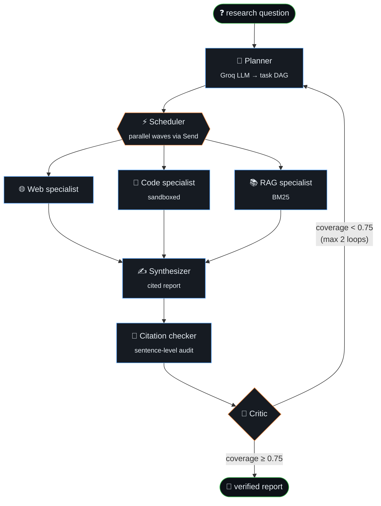

<div align="center">

<a href="https://muhammadmaheem.github.io/MuhammadMaheem.Portfolio/">
  
</a>

<br>

<a href="https://muhammadmaheem.github.io/MuhammadMaheem.Portfolio/"></a>
<a href="https://www.linkedin.com/in/muhammad-maheem/"></a>
<a href="https://github.com/MuhammadMaheem"></a>
<a href="https://muhammadmaheem.github.io/MuhammadMaheem.Portfolio/Muhammad-Maheem-Resume.pdf"></a>
<a href="mailto:mirza.muhammad.maheem@gmail.com"></a>
<br>


</div>

<br>

> [!TIP]
> **This README is a working system, not a page.** Two GitHub Actions keep it alive: one redraws my commit history as a heartbeat every night, the other runs a chess engine I wrote that plays anyone who scrolls to the bottom. [Skip to the game ↓](#-play-chess-against-my-engine)

## 🧭 Choose your route

<details>
<summary><b>👔 &nbsp;I'm hiring — give me the 30-second version</b></summary>
<br>

| 🎯 | |
| :-- | :-- |
| **Looking for** | Onsite **AI Engineer** roles in **Lahore** |
| **Strongest at** | RAG pipelines · multi-agent orchestration with LangGraph · LLM evaluation (RAGAS quality gates in CI) |
| **Experience** | 3 internships: legal-tech & HR-tech AI at **TEYZIX CORE**, sole engineer on a government SaaS at **PSDA**, RAG + SaaS UI at **AABS** |
| **Shipped** | 16+ projects, including live deployments on Vercel + Railway |
| **Daily stack** | Python · FastAPI · LangGraph · TypeScript · Next.js · PostgreSQL · Docker |
| **Education** | BS Artificial Intelligence, Superior University (2024 – 2028) · CGPA 3.56 |
| **Reach me** | [mirza.muhammad.maheem@gmail.com](mailto:mirza.muhammad.maheem@gmail.com) · [LinkedIn](https://www.linkedin.com/in/muhammad-maheem/) · [Portfolio](https://muhammadmaheem.github.io/MuhammadMaheem.Portfolio/) · [Résumé (PDF)](https://muhammadmaheem.github.io/MuhammadMaheem.Portfolio/Muhammad-Maheem-Resume.pdf) |

</details>

<details>
<summary><b>🛠️ &nbsp;I'm an engineer — show me how you build</b></summary>
<br>

- **Architecture:** my flagship [multi-agent research swarm](#-flagship--autonomous-research-agent-swarm) (planner → parallel specialists → critic loop).
- **This repo is code, too:**
  - [`scripts/chess_game.py`](scripts/chess_game.py): negamax + alpha-beta, quiescence search, piece-square tables, all driven by GitHub Issues.
  - [`scripts/heartbeat.py`](scripts/heartbeat.py): GitHub GraphQL → hand-built ECG path → animated SVG, no chart library.
  - [`.github/workflows/`](.github/workflows): the two Actions that run both on their own.
- **Everything else** is in the [agent registry](#-agent-registry) below.

</details>

## 🫀 Pulse

<div align="center">
  
  <br>
  <sub>Every spike is one week of commits. Taller spike, busier week. Redrawn every night by <a href=".github/workflows/heartbeat.yml">a GitHub Action</a>.</sub>
</div>

## 🐝 Flagship · Autonomous Research Agent Swarm

Ask a research question. A **planner** breaks it into a DAG and sends **specialist agents** out in parallel waves. A **synthesizer** writes a cited report. A **critic** checks claim coverage and sends the work back if it isn't good enough.



**LangGraph** state machine with persistence and loops · **FastAPI** streaming every step over SSE · **Next.js + React Flow** showing the live DAG · **SQLite** event store for traces · an **eval harness** comparing the full swarm against a no-critic ablation and a single-agent baseline.

[](https://github.com/MuhammadMaheem/Autonomous-Research-Agent-Swarm)

## 📜 `git log --graph --career`

```text
* Jun 2026 — Jul 2026  (HEAD -> ai-engineer)  AI Engineer Intern @ TEYZIX CORE
|   + legal-tech contract risk analyzer: 7-stage async pipeline (FastAPI + Next.js 15),
|     clause extraction, risk flags with confidence scores, explainable compliance score
|     via RAG over ChromaDB
|   + RecruitAI: resume screening & candidate ranking with Groq + ChromaDB, live on Vercel + Railway
|   + hybrid summarizer: TF-IDF/positional extractive + BART abstractive, 16+ languages
|
* Mar 2026 — May 2026  (tag: sole-engineer)  AI Developer Intern @ Punjab Skill Development Authority (PSDA)
|   + delivered a full-stack SaaS alone, from Figma specs to production (Next.js, Tailwind, PostgreSQL)
|   + public site, admin dashboard, 3-role permission system across 8+ REST endpoints
|   + Gemini-powered OCR parser wired into the backend for multi-page document processing
|
* Sep 2025 — Nov 2025  (tag: first-rag)  Software Engineer Intern @ Artificial Automation Business Solutions (AABS)
|   + RAG PDF chatbot: embedding model selection, ChromaDB indexing, grounded answers
|   + SaaS dashboard UI in Next.js 15 / React 19: auth, analytics, subscriptions
|
* 2024 — 2028         (root)  git init — BS Artificial Intelligence @ Superior University, Lahore (5th semester)
```

## 🧩 Agent registry

Every project is listed as an agent: what it does, what runs it, and where to find it.

| Agent | Mission | Runtime | |
| :-- | :-- | :-- | :-: |
| 🐝 **research-swarm** | Multi-agent research with a critic loop and verified citations | LangGraph · FastAPI · Next.js | [↗](https://github.com/MuhammadMaheem/Autonomous-Research-Agent-Swarm) |
| ⚖️ **contract-auditor** | Reads contracts (scanned PDFs too), flags risky clauses with confidence scores, exports PDF/DOCX reports | FastAPI · Next.js · ChromaDB · OCR | [↗](https://github.com/MuhammadMaheem/Contact-Risk-Analyzer) |
| 🧑‍💼 **recruit-ai** | Screens résumés and ranks candidates against a job description with a 100-point score | Groq · ChromaDB · Next.js | [↗](https://github.com/MuhammadMaheem/RecruitAI) · [live](https://recruit-ai-mu.vercel.app) |
| 🧪 **docuquery** | RAG chatbot that blocks deploys when the RAGAS score drops below 0.80 | FastAPI · LangGraph · RAGAS · Groq | [↗](https://github.com/MuhammadMaheem/Quality-Evaluation-RAG-chatbot) |
| 🤖 **agentic-rag** | Agentic RAG over PDFs with multi-query expansion, streaming answers and JWT auth | FastAPI · Next.js · PostgreSQL | [↗](https://github.com/MuhammadMaheem/PDF-Chatbot-Rag) |
| 📗 **hadith-scholar** | Semantic search over 39,038 hadiths: BM25 pre-filter → FAISS re-rank | LangChain · FAISS | [↗](https://github.com/MuhammadMaheem/Hadith-Chatbot) |
| 📝 **summarizer** | Hybrid extractive + abstractive (BART) summaries, multi-document, 16+ languages | Flask · Transformers | [↗](https://github.com/MuhammadMaheem/AI-Powered-Document-Summarization-System) |
| 🎮 **dqn-player** | Deep Q-Network trained over 100k self-play games, >98% win/draw vs optimal play | PyTorch · RL | [↗](https://github.com/MuhammadMaheem/tic-tac-toe-Deep-Q-learning) |
| 🙂 **face-attendance** | Face-recognition attendance with liveness detection against photo/video spoofing | OpenCV · Dlib · Streamlit | 🔒 |

## ⚙️ Runtime

<div align="center">


<br>


</div>

```yaml
# ~/.maheem/runtime.yaml
llm:        [Groq / Llama 3, Gemini, Claude]
agents:     [LangGraph, LangChain, MCP servers]
retrieval:  [ChromaDB, FAISS, BM25 hybrid, re-ranking]
evals:      [RAGAS quality gates in CI, golden datasets, ablation studies]
ml:         [PyTorch, scikit-learn, OpenCV, Dlib, DQN]
ship:       [FastAPI, Next.js 15, PostgreSQL, Docker, Vercel, Railway, Neon]
tooling:    [uv, Git, Linux, Claude Code]
```

## ♟️ Play chess against my engine

<!-- CHESS:START -->
<div align="center">

**Game #1** · move 1 · Humans **0** – **0** Engine · 0 draws


</div>

**Your move — you're White.** Click a move below, GitHub opens a pre-filled issue, press **Submit**. A depth-3 alpha-beta engine I wrote answers as Black within a minute.

| Piece | Legal moves |
| :-- | :-- |
| ♙ Pawn | [`a3`](https://github.com/MuhammadMaheem/MuhammadMaheem/issues/new?title=chess%7Cmove%7Ca2a3%7C0&body=Just%20press%20%2A%2ASubmit%20new%20issue%2A%2A%20%E2%80%94%20no%20need%20to%20write%20anything.%20The%20engine%20replies%20in%20about%20a%20minute.) [`a4`](https://github.com/MuhammadMaheem/MuhammadMaheem/issues/new?title=chess%7Cmove%7Ca2a4%7C0&body=Just%20press%20%2A%2ASubmit%20new%20issue%2A%2A%20%E2%80%94%20no%20need%20to%20write%20anything.%20The%20engine%20replies%20in%20about%20a%20minute.) [`b3`](https://github.com/MuhammadMaheem/MuhammadMaheem/issues/new?title=chess%7Cmove%7Cb2b3%7C0&body=Just%20press%20%2A%2ASubmit%20new%20issue%2A%2A%20%E2%80%94%20no%20need%20to%20write%20anything.%20The%20engine%20replies%20in%20about%20a%20minute.) [`b4`](https://github.com/MuhammadMaheem/MuhammadMaheem/issues/new?title=chess%7Cmove%7Cb2b4%7C0&body=Just%20press%20%2A%2ASubmit%20new%20issue%2A%2A%20%E2%80%94%20no%20need%20to%20write%20anything.%20The%20engine%20replies%20in%20about%20a%20minute.) [`c3`](https://github.com/MuhammadMaheem/MuhammadMaheem/issues/new?title=chess%7Cmove%7Cc2c3%7C0&body=Just%20press%20%2A%2ASubmit%20new%20issue%2A%2A%20%E2%80%94%20no%20need%20to%20write%20anything.%20The%20engine%20replies%20in%20about%20a%20minute.) [`c4`](https://github.com/MuhammadMaheem/MuhammadMaheem/issues/new?title=chess%7Cmove%7Cc2c4%7C0&body=Just%20press%20%2A%2ASubmit%20new%20issue%2A%2A%20%E2%80%94%20no%20need%20to%20write%20anything.%20The%20engine%20replies%20in%20about%20a%20minute.) [`d3`](https://github.com/MuhammadMaheem/MuhammadMaheem/issues/new?title=chess%7Cmove%7Cd2d3%7C0&body=Just%20press%20%2A%2ASubmit%20new%20issue%2A%2A%20%E2%80%94%20no%20need%20to%20write%20anything.%20The%20engine%20replies%20in%20about%20a%20minute.) [`d4`](https://github.com/MuhammadMaheem/MuhammadMaheem/issues/new?title=chess%7Cmove%7Cd2d4%7C0&body=Just%20press%20%2A%2ASubmit%20new%20issue%2A%2A%20%E2%80%94%20no%20need%20to%20write%20anything.%20The%20engine%20replies%20in%20about%20a%20minute.) [`e3`](https://github.com/MuhammadMaheem/MuhammadMaheem/issues/new?title=chess%7Cmove%7Ce2e3%7C0&body=Just%20press%20%2A%2ASubmit%20new%20issue%2A%2A%20%E2%80%94%20no%20need%20to%20write%20anything.%20The%20engine%20replies%20in%20about%20a%20minute.) [`e4`](https://github.com/MuhammadMaheem/MuhammadMaheem/issues/new?title=chess%7Cmove%7Ce2e4%7C0&body=Just%20press%20%2A%2ASubmit%20new%20issue%2A%2A%20%E2%80%94%20no%20need%20to%20write%20anything.%20The%20engine%20replies%20in%20about%20a%20minute.) [`f3`](https://github.com/MuhammadMaheem/MuhammadMaheem/issues/new?title=chess%7Cmove%7Cf2f3%7C0&body=Just%20press%20%2A%2ASubmit%20new%20issue%2A%2A%20%E2%80%94%20no%20need%20to%20write%20anything.%20The%20engine%20replies%20in%20about%20a%20minute.) [`f4`](https://github.com/MuhammadMaheem/MuhammadMaheem/issues/new?title=chess%7Cmove%7Cf2f4%7C0&body=Just%20press%20%2A%2ASubmit%20new%20issue%2A%2A%20%E2%80%94%20no%20need%20to%20write%20anything.%20The%20engine%20replies%20in%20about%20a%20minute.) [`g3`](https://github.com/MuhammadMaheem/MuhammadMaheem/issues/new?title=chess%7Cmove%7Cg2g3%7C0&body=Just%20press%20%2A%2ASubmit%20new%20issue%2A%2A%20%E2%80%94%20no%20need%20to%20write%20anything.%20The%20engine%20replies%20in%20about%20a%20minute.) [`g4`](https://github.com/MuhammadMaheem/MuhammadMaheem/issues/new?title=chess%7Cmove%7Cg2g4%7C0&body=Just%20press%20%2A%2ASubmit%20new%20issue%2A%2A%20%E2%80%94%20no%20need%20to%20write%20anything.%20The%20engine%20replies%20in%20about%20a%20minute.) [`h3`](https://github.com/MuhammadMaheem/MuhammadMaheem/issues/new?title=chess%7Cmove%7Ch2h3%7C0&body=Just%20press%20%2A%2ASubmit%20new%20issue%2A%2A%20%E2%80%94%20no%20need%20to%20write%20anything.%20The%20engine%20replies%20in%20about%20a%20minute.) [`h4`](https://github.com/MuhammadMaheem/MuhammadMaheem/issues/new?title=chess%7Cmove%7Ch2h4%7C0&body=Just%20press%20%2A%2ASubmit%20new%20issue%2A%2A%20%E2%80%94%20no%20need%20to%20write%20anything.%20The%20engine%20replies%20in%20about%20a%20minute.) |
| ♘ Knight | [`Na3`](https://github.com/MuhammadMaheem/MuhammadMaheem/issues/new?title=chess%7Cmove%7Cb1a3%7C0&body=Just%20press%20%2A%2ASubmit%20new%20issue%2A%2A%20%E2%80%94%20no%20need%20to%20write%20anything.%20The%20engine%20replies%20in%20about%20a%20minute.) [`Nc3`](https://github.com/MuhammadMaheem/MuhammadMaheem/issues/new?title=chess%7Cmove%7Cb1c3%7C0&body=Just%20press%20%2A%2ASubmit%20new%20issue%2A%2A%20%E2%80%94%20no%20need%20to%20write%20anything.%20The%20engine%20replies%20in%20about%20a%20minute.) [`Nf3`](https://github.com/MuhammadMaheem/MuhammadMaheem/issues/new?title=chess%7Cmove%7Cg1f3%7C0&body=Just%20press%20%2A%2ASubmit%20new%20issue%2A%2A%20%E2%80%94%20no%20need%20to%20write%20anything.%20The%20engine%20replies%20in%20about%20a%20minute.) [`Nh3`](https://github.com/MuhammadMaheem/MuhammadMaheem/issues/new?title=chess%7Cmove%7Cg1h3%7C0&body=Just%20press%20%2A%2ASubmit%20new%20issue%2A%2A%20%E2%80%94%20no%20need%20to%20write%20anything.%20The%20engine%20replies%20in%20about%20a%20minute.) |

<!-- CHESS:END -->

## 📡 Get in touch

<div align="center">

Hiring for an AI Engineer role in Lahore, or want to build something together? I reply fast.

<a href="https://muhammadmaheem.github.io/MuhammadMaheem.Portfolio/"></a>
<a href="https://www.linkedin.com/in/muhammad-maheem/"></a>
<a href="https://github.com/MuhammadMaheem?tab=repositories"></a>
<a href="https://muhammadmaheem.github.io/MuhammadMaheem.Portfolio/Muhammad-Maheem-Resume.pdf"></a>
<a href="mailto:mirza.muhammad.maheem@gmail.com"></a>

</div>

---

<div align="center">

```text
❯ swarm status
  all agents idle · critic satisfied · recruiter inbox: open  →  mirza.muhammad.maheem@gmail.com
```

</div>
